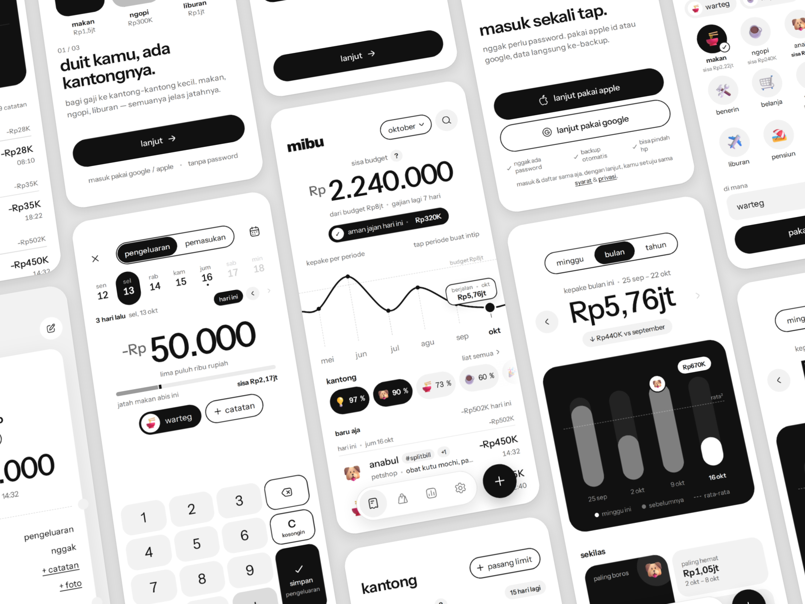
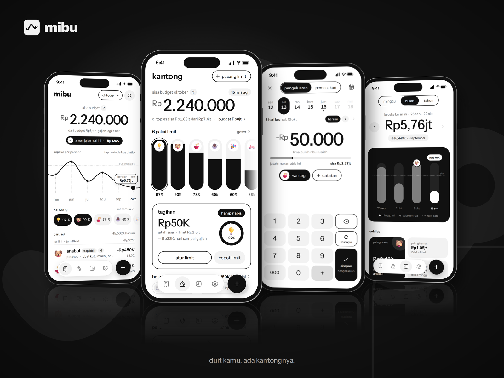
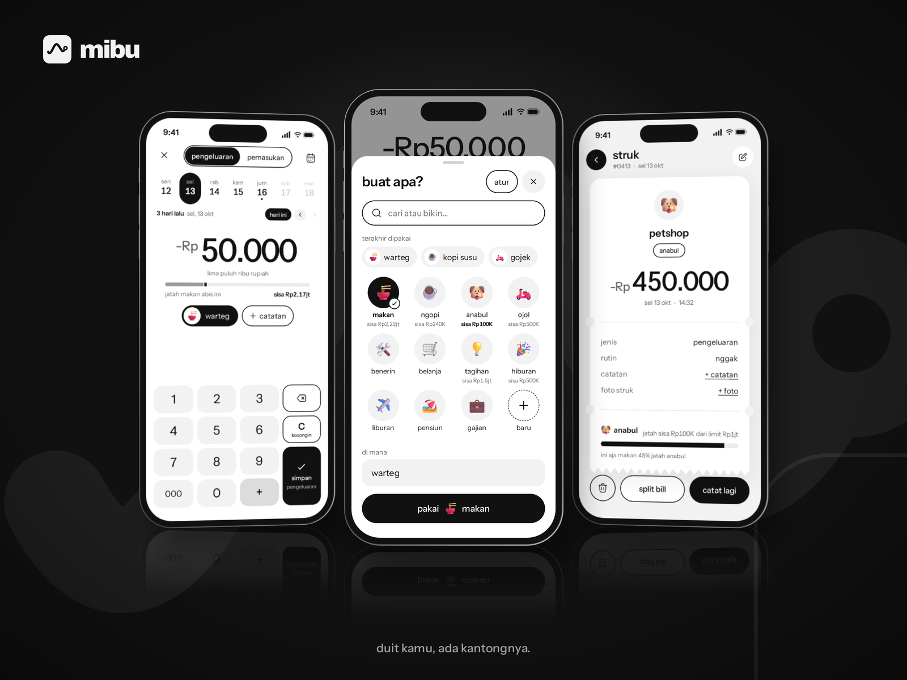
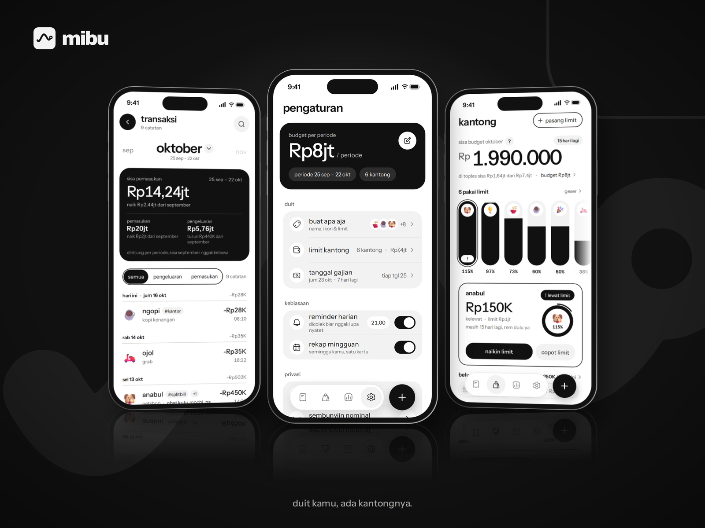

<h1 align="center">mibu</h1>

A personal finance app for iOS and Android, made for everyday life in Indonesia.

  
  

    
More screens

    
    
    
  

Track income and expenses, plan spending around payday, and set limits for the things that matter to you. mibu shows how much is left in your budget and what you can safely spend each day.

Your data stays on your device. No account or internet connection required.
