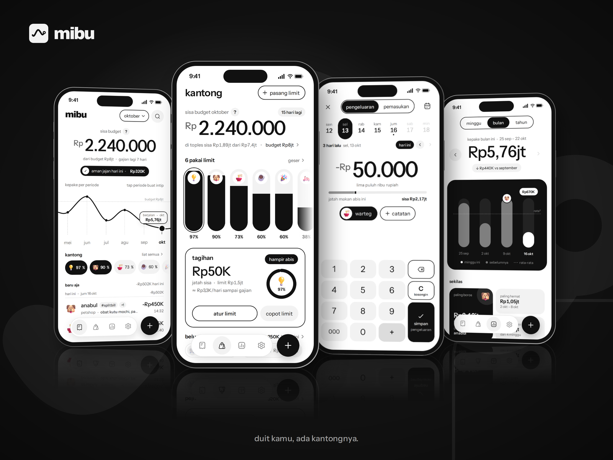
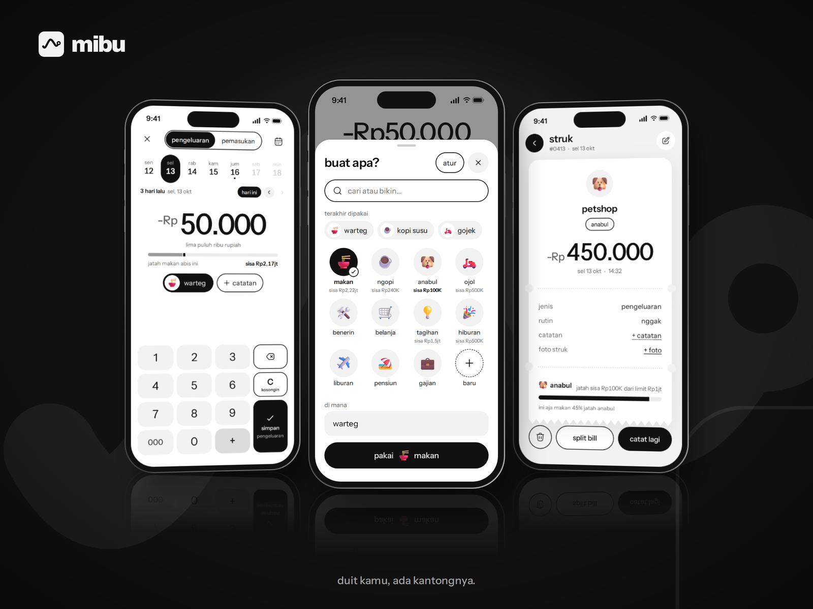
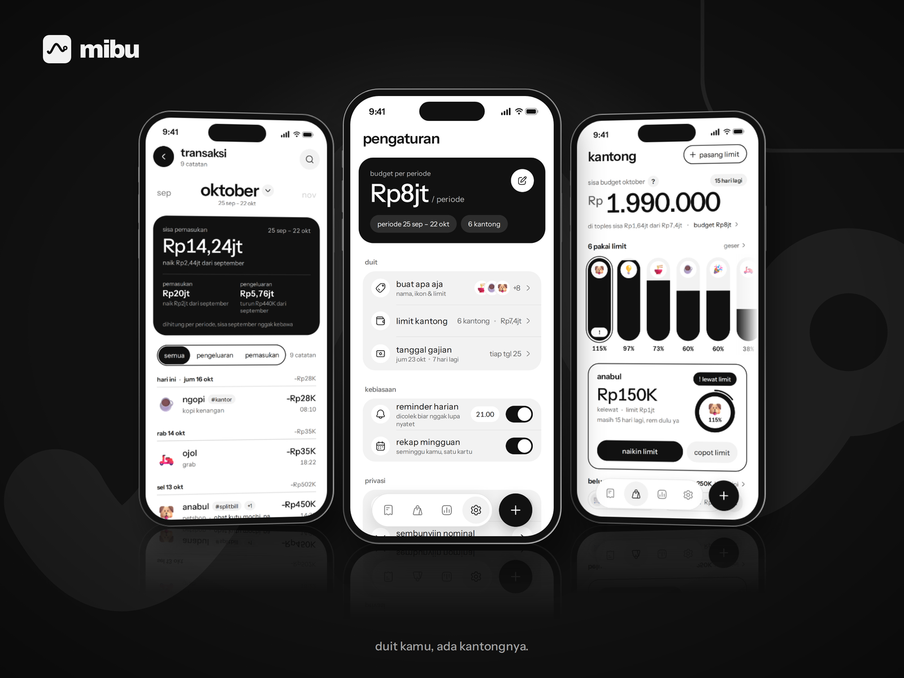

<h1 align="center">mibu</h1>

<p align="center">
  Catat duit, ada kantongnya. Pencatat keuangan pribadi untuk iOS dan Android, rupiah, semua data tersimpan di HP.
</p>

<div align="center">
  

<details>
<summary>Intip showcase lainnya</summary>
<br>
  
  <br><br>
  
</details>
</div>

## Features

- **Catat dalam 3 detik**: keypad rupiah, pilih buat apa, selesai. Catatan dan tag opsional, tanggal bisa mundur.
- **Periode ikut tanggal gajian**: budget dan angka dihitung per periode, bukan per bulan kalender. Gajian jatuh weekend bisa digeser atau tetap.
- **Kantong**: buat apa yang dikasih limit jadi toples, isinya ikut kepake. Ada peringatan hampir abis dan kelewat limit.
- **Aman jajan**: jatah harian dari sisa budget sampai gajian berikutnya.
- **Statistik** minggu, bulan, dan tahun, plus ritme budget.
- **Cari** di semua transaksi, **detail struk** dengan undo hapus, **sembunyiin nominal**.
- **Export dan import CSV**, termasuk CSV dari Excel.

Tanpa login dan tanpa backend: semua data lokal di SQLite (Drift). Tidak ada yang keluar dari device.

## Tech stack

Flutter ([FVM](https://fvm.app)) · Riverpod · Drift · go_router · `intl` (id-ID) · HugeIcons · gen-l10n (`app_id.arb`).

## Getting started

Butuh Flutter lewat FVM, plus Xcode (iOS) dan/atau Android SDK.

```bash
make get      # pub get
make gen      # drift codegen
make check    # format, analyze, test
make run      # debug di device / simulator
make help     # semua perintah
```

Data contoh untuk debug: `make run seed=demo|fixture|none`. `make fresh` = install baru tiap launch, `make reset` = hapus data lalu seed ulang. Build release selalu mulai kosong.

Build ke device: `make dev` / `make dev-android` (mibu dev, id `com.mibu.mibu.dev`, data terpisah, branch apa saja), `make release` / `make release-android` / `make apk` (mibu, `com.mibu.mibu`, hanya dari `main`).

Signing release Android: buat `apps/mobile/android/key.properties` (gitignored) berisi `storeFile`, `storePassword`, `keyAlias`, `keyPassword`. Tanpa file itu build release memakai debug key. Ganti signature berarti app yang sudah ter-install tidak bisa di-update, jadi jangan diganti kalau datanya masih dipakai.
