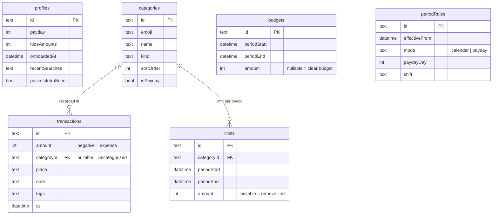

# mibu — MVP specification

The MVP is a fully local personal finance ledger for Indonesia, denominated in whole rupiah (IDR). Screen IDs (02.1, 07.2, etc.) refer to boards in the Claude Design canvas. The full screen inventory is in [features.md](features.md).

## Product principles

- **Fully local.** Data lives on the device in Drift (SQLite). There is no login or backend.
- **Period ledger, not bank balance.** mibu records income and expenses for each payday period. Nothing carries over between periods; mibu does not represent a bank account balance. See [period-ledger.md](period-ledger.md).
- **Derived values are not stored.** Period income, spending, remaining budget, pocket usage, and statistics are calculated from transactions and the applicable budget/limit rows.
- **Sync-friendly identifiers.** Rows use UUIDs and timestamps, including soft-delete timestamps. This leaves room for future sync without changing IDs; it does not imply that sync exists today.

## Product scope

The app includes onboarding/setup (01.1, 01.4, 01.4b), home (02.1), pockets (03.1), statistics (04.1), settings (05.1), entry and category selection (06.1–07.4), search and transaction detail/edit (08.1–08.3), and the transaction list (09.1). CSV export and import are available in settings. Consult [features.md](features.md) for the current screen behavior and [GitHub issues](https://github.com/choiruladamm/mibu/issues) for work that is still open.

Deferred product ideas include account login and cloud sync, full backup and restore, recurring transactions, reminders, goals, pocket top-ups, split bills, receipt photos, dark mode, and future-dated entries. Authentication (01.2) is intentionally skipped. Do not implement deferred ideas unless requested.

First run: onboarding 01.1 → setup 01.4 → optional first pockets 01.4b → home 02.1. Setup can be skipped; it does not require a budget.

## Data model

The current Drift schema is defined in `apps/mobile/lib/data/database/app_database.dart`. IDs are UUID v4 text. Every table includes `createdAt`, `updatedAt`, and nullable `deletedAt` columns for soft deletion and possible future sync.



`profiles` has one active row. Transactions may have no category. Amounts are signed integers in whole rupiah: expenses are negative and income is positive. `tags` is comma-separated and supports up to 3 tags. `at` is local date and time. The `isPayday` flag identifies salary income for payday-cycle behavior.

Budgets and category limits are stored per period. For a given period, the effective row is the one with the latest `periodStart` that is at or before that period's start. Periods without their own row inherit the latest prior value; changing a value adds a row for the current period, preserving history. A `null` amount clears a budget or removes a limit from that period onward. Reads do not write rows. With no saved period rules, periods use calendar months.

The current database tables are `Profiles`, `Categories`, `Transactions`, `PeriodRules`, `Budgets`, and `Limits`. `Profile.monthlyBudget` is a repository/domain value backed by the effective `Budgets` row, not a stored profile column.

### Soft deletion and undo

- Delete by setting `deletedAt`; `batalin` clears it.
- Before deleting a category, move its transactions to another category or to no category. Undo restores both the transactions and category.
- Soft-deleted rows older than one day are purged at app startup.

### Future sync shape

If sync is added later, upload rows whose `updatedAt` is newer than the last sync, including rows with `deletedAt`, so deletions propagate. Account ownership and conflict handling still need a product and technical decision. IDs do not need to change.

## Business rules

### Payday periods

One `PeriodResolver` determines periods for budgets, limits, pockets, safe-to-spend, statistics, search, the transaction list, month navigation, and the home chart. A payday on day 1 gives calendar months when the boundary is not shifted by the weekend or an early salary. See [payday-cycle.md](payday-cycle.md) for the resolver and [payday-change.md](payday-change.md) for changes to payday dates.

- A period runs from one payday to the next. Its label is the month containing most of its days: paydays on or after the 16th use the ending month ("oktober" = 25 sep – 24 okt); earlier paydays use the starting month. `periodForMonth` maps the month chosen in the UI to its period.
- A payday date beyond a month's length (including 31 / "akhir") resolves to that month's last day. When configured to shift, a weekend payday moves to the previous Friday. The resolver supports supplied holidays, but the app does not provide a holiday calendar.
- Income in category `gajian`, recorded within `paydayEarlyDays` (3 days) before the scheduled payday, starts the new period on the recorded date. A late salary does not extend the period.
- Period rules cover history, so back-filled transactions before installation still resolve to their correct periods.
- A payday-date change applies from the next period, except during the setup period when it can correct an initial choice. A transition period may be shorter or longer; budget and limit amounts are prorated against `Period.normalDays` so the daily allowance remains consistent. See [payday-change.md](payday-change.md).
- Without a saved rule, `seedFixture` uses calendar months.

### Safe-to-spend today

The home chip is based only on the current period's remaining budget, never on income. For period `P`:

```
spent(P)       = Σ expenses in P
remaining(P)   = budget(P) − spent(P)
daysLeft(P)    = days through the period end, including today

safe = floor((remaining(P) + expensesToday) / daysLeft(P)) − expensesToday
```

Adding `expensesToday` before division and subtracting it afterward means today's expenses reduce today's allowance without counting them twice. `daysLeft(P)` is `Period.daysLeft(today)` and is never zero inside a period.

- If there is no budget, show the prompt to set one; do not infer an amount.
- If `remaining(P) < 0`, show `rem dulu ya · N hari lagi` instead of a positive allowance.
- If `safe < 0`, show `kebablasan Rp X hari ini`; zero remains a safe-to-spend amount.
- On payday when salary is not recorded, or for up to 7 days after a missed payday, show the existing prompt to record salary. Do not divide by zero.
- Expenses recorded today reduce today's allowance. Income does not change the allowance; it changes period income analytics only.

Example: if the current period has Rp4,000,000 budget, Rp2,200,000 spent including Rp100,000 spent today, and 10 days left including today, then `safe = floor((1,800,000 + 100,000) / 10) − 100,000 = Rp90,000`.

### Period totals and budget

For each period `P`, ignoring rows with non-null `deletedAt`:

```
income(P)           = Σ income in P
spent(P)            = Σ expenses in P, as a positive value
remainingIncome(P)  = income(P) − spent(P)             -- analytics
remainingBudget(P)  = budget(P) − spent(P)
remainingPockets(P) = Σ pocket limits − pocket spending
```

`remainingIncome` is analytics, not spendable balance. It may be negative. If no income has been recorded, the transaction list can show `—` with `catat gajian dulu` where appropriate. Freelance and other non-salary income count toward period income but do not change the budget.

Example: salary Rp15jt on 25 Sep, freelance Rp2jt on 2 Oct, budget Rp7jt, and spending Rp3jt in the same period:

| | Value |
|---|---|
| Period income | 15jt + 2jt = 17jt |
| Remaining income | 17jt − 3jt = **14jt** |
| Remaining budget | 7jt − 3jt = **4jt** |
| Income above budget | Unallocated allowance (for example, savings) |

Freelance increases remaining income; it does not change the budget unless the user changes the budget.

### Categories, limits, and pockets

There is one concept: a category (`categories`, shown in the UI as "buat apa"). A pocket is a category with an expense limit, shown visually as a jar on the pockets tab.

- Category selection in 06.2 is optional. An uncategorized transaction still counts toward period spending and budget, but not toward any pocket. It can be corrected in 08.3.
- A monthly limit applies only to expense categories. The label "kantong" describes the tab and jar visual; UI actions use "limit": `pasang limit`, `atur limit`, `copot limit`. The remaining amount for a category is "jatah X".
- `+ pasang limit` in 03.1 selects an existing unlimited category, ordered by spending this period, then opens PocketLimit. It does not create a category. `bikin kategori baru` is available below the picker.
- Default limit in the sheet = `max(Rp300K, ceil(spent this period × 1.4 ÷ 100K) × 100K)`.
- `copot limit` uses a confirmation sheet, writes a `null` limit for the current period, and offers `batalin`. The category and transactions remain. This differs from deleting a category (07.4).
- Duplicate categories are handled through category deletion and moving their transactions; there is no separate merge action.
- New categories from 06.2 / 07.1 have no limit by default. Creating one from the pockets flow assigns a limit.

Pocket formulas and states:

```
remainingPockets = Σ limits − Σ spending in limited categories
percentUsed      = round(spent ÷ limit × 100)
```

- `lewat limit` when percent used > 100% (exactly 100% is `hampir abis`).
- `hampir abis` when percent used ≥ 85%.
- `belum kepake` when spending = 0.
- Otherwise `aman`.
- "kira-kira Rp… sehari" = remaining amount ÷ days left in the current period.

PocketLimit 00.15:

```
free = budget − Σ limits for other pockets   (exclude this pocket when editing)
sliderEnd = min(budget, max(1jt, ceil(free × 2 ÷ 500K) × 500K))
step = 50K (budget ≤ 5jt) · 100K (≤ 20jt) · 250K (above 20jt)
```

- The dashed line marks `free` ("sisa budget Rp…"). Manual entry may exceed the slider end; the thumb stays at the right edge. Hard limit: Rp100jt, up to 9 digits.
- If limit > `free`, show bold "lewat Rp…"; saving is still allowed. Otherwise, show "≈ Rp… sehari" = limit ÷ current period length.
- If `monthlyBudget` is null, show the link to set a monthly budget and use Rp2jt as slider end.
- Only expense categories can have pockets; hide the switch for income categories.

### Statistics

- Distinguish loading, error (with retry), and empty data. A period with no expenses gets an explanation rather than a blank card.
- Show information for an old period without a budget; only the current period can offer the action to set one.
- Average uses completed bars only, except that the current bar is included when it is the only bar. Do not count bars before the first transaction as zero-spend periods.
- Period bars split the period into 7-day spans from its first day. Combine a final 1–3 days with the preceding bar, so the last bar is 8–10 days and no sliver bar appears.
- The year view has 12 named periods, January through December. With payday on or after the 16th, January's period can start in December. Labels use period names, not start dates. Annual budget limit is the sum of each period's applicable budget from the first period with data through December; a period without its own budget uses the nearest applicable budget.
- Budget rhythm uses `monthlyBudget` (`B`) only, not the sum of pocket limits. Spending includes uncategorized expenses and categories without pockets, so pocket limits are not a fair comparison.

```
weeklyLimit = B × 7 ÷ period length   (for a week spanning periods, use the period containing Monday)
periodLimit = B
yearLimit   = Σ period budgets from the first period with data through December

week / period: spent > limit → over budget
               spent ≥ 85% of limit → nearly used
               otherwise → on track
year:          spent > limit → over budget
               percent spent < percent of year elapsed → below budget
               otherwise → on track
```

For prior periods, use the budget effective in that period. If `B` is null, replace the budget-rhythm section with the prompt to set a budget; other statistics remain available.

### Input

- Amounts are digits only, with no leading zero. Keypad input is limited to 10 digits; setup amounts may use up to 12 digits.
- Future dates cannot be selected for transaction entry. Period navigation varies by screen; CSV import can contain future-dated transactions.
- Income categories (such as salary) appear only when recording income.

### Hide amounts

`profile.hideAmounts` is `none` · `income` · `all` (05.1h–i; details in [hide-income.md](hide-income.md)). Settings 05.1 opens a three-choice sheet with a live example; saving shows a toast with `batalin`.

- `all`: mask all amounts as `Rp•••` (home, pockets, TxRow, detail, budget, statistics).
- `income`: mask income and values from which income can be inferred: income TxRow/detail, days with income, 09.1 period income / remaining income / delta, 08.1 summary when results include income, and the 06.1 "pemasukan periode ini jadi" bar. Home, pockets, statistics, and budget amounts remain visible.
- Use `context.rp*(v, income: true)` for income-side amounts.
- Reveal by tapping the main amount (home or detail) or the `intip 5 detik` chip in 09.1. Hide again after 5 seconds, on another tap, or when leaving the screen.

Amounts in the keypad and CSV export are not masked.

## CSV export

- Columns: `tanggal,jam,jenis,nominal,kategori,emoji,tempat,catatan,tag`.
  - `tanggal`: `yyyy-MM-dd`
  - `jam`: `HH:mm`
  - `jenis`: `pengeluaran` or `pemasukan`
  - `nominal`: positive whole number without separators
  - `tag`: space-separated
- UTF-8 with BOM for emoji compatibility in Excel. Standard RFC 4180 CSV escaping.
- Export all transactions with null `deletedAt`, newest first.
- Filename: `mibu-yyyyMMdd.csv`, shared through the system share sheet.
- Dependency: `share_plus`.

## CSV import

Import mibu's own exported file (05.1l–o, ImportSheet 00.30). Duplicate handling, new categories, and undo are documented in [import.md](import.md). Dependency: `file_picker`.

## Architecture and project workflow

- Follow the existing layered MVVM + Riverpod structure (`ui/features/*/views` + `view_models`).
- `FinanceRepository` lives in `data/repositories`; split it only if it becomes too large.
- Pure domain functions and tests own business calculations (periods, safe-to-spend, statistics, CSV).
- Repository tests use `NativeDatabase.memory()`.
- Debug sample data is seeded only under `kDebugMode`. `seedFixture` is stable test/design data; `seedDemo` is realistic device data. See [CLAUDE.md](../CLAUDE.md) for the project's seed workflow.
- The app has been released and contains real user data. Never edit a shipped table in place, lower `schemaVersion`, or delete user data as a shortcut. Schema changes require a forward migration and a migration test that proves old data survives; follow [CLAUDE.md](../CLAUDE.md).

## Risks and limitations

- **Device loss or uninstall:** data is local. CSV export is the available transaction-history backup; it does not include budget, limits, or payday rules. Full backup and restore is not implemented.
- **Import scope:** CSV restores transactions and categories only; budget, limits, and payday settings must be set again manually.
